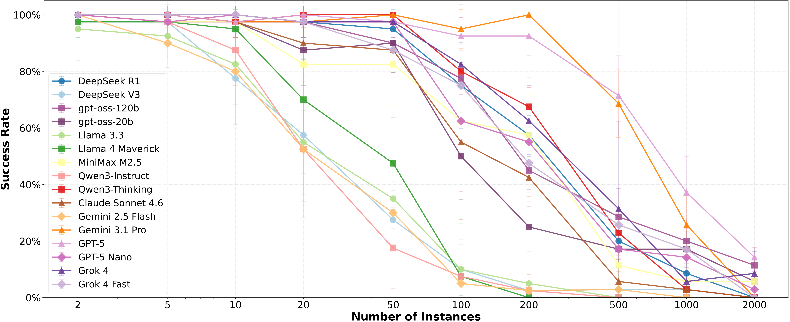

# Understanding LLM Performance Degradation in Multi-Instance Processing: The Roles of Instance Count and Context Length

<p align="center">
  <a href="https://arxiv.org/abs/2603.22608">
    
  </a>
  <a href="https://huggingface.co/datasets/jingxuanchen916/mip-understanding">
    
  </a>
</p>

In multi-instance processing (MIP), an LLM processes many individual inputs and combines their results into a single answer. This dataset covers eight tasks with 2 to 2,000 instances per prompt, asking models to aggregate over all instances. Our study finds that LLM performance drops as the number of instances grows, with instance count having a stronger effect than context length alone.

<p align="center">
  
</p>

## Data

```python
from datasets import load_dataset

data = load_dataset("jingxuanchen916/mip-understanding", split="test")
```

The [dataset card](https://huggingface.co/datasets/jingxuanchen916/mip-understanding) describes the
tasks and the columns.

## Evaluate a model

```bash
pip install -r requirements.txt
export OPENROUTER_API_KEY=...   # sent only to OpenRouter; another endpoint reads API_KEY
python run.py --model meta-llama/llama-4-scout             # --base-url for e.g. a local vLLM server
python score.py results/*.jsonl --by task n_instances
```

`run.py` writes one line per prompt to `results/<model>.jsonl` and skips the rows already there
when re-run; `--task` and `--limit` run a subset. The defaults follow the paper: temperature 0, at
most 20,000 output tokens, and up to 3 attempts when no answer can be parsed. The prompts
(`prompts.yaml`) are the paper's with a JSON-only answer format, so results can differ slightly
from the paper's.

## Our work on Multi-Instance Processing (MIP)

<table>
  <tr>
    <td><b>MIP-Understanding</b></td>
    <td><a href="https://aclanthology.org/2026.acl-long.1470/">Understanding LLM Performance Degradation in Multi-Instance Processing: The Roles of Instance Count and Context Length</a> (ACL 2026)</td>
    <td><a href="https://github.com/jingxuanchen916/mip-understanding">💻 Code</a></td>
    <td><a href="https://huggingface.co/datasets/jingxuanchen916/mip-understanding">🤗 Dataset</a></td>
  </tr>
  <tr>
    <td><b>MIP-Order</b></td>
    <td><a href="https://arxiv.org/abs/2610.29057">Does Every Instance Count Equally? Order Effects in LLM Multi-Instance Processing</a></td>
    <td><a href="https://github.com/jingxuanchen916/mip-order">💻 Code</a></td>
    <td><a href="https://huggingface.co/datasets/jingxuanchen916/mip-order">🤗 Dataset</a></td>
  </tr>
</table>

## Citation

Please cite the [ACL 2026 paper](https://aclanthology.org/2026.acl-long.1470/) if you use any of
the resources in this repository.

```bibtex
@inproceedings{chen-etal-2026-understanding-llm,
    title = "Understanding {LLM} Performance Degradation in Multi-Instance Processing: The Roles of Instance Count and Context Length",
    author = "Chen, Jingxuan  and
      Pilehvar, Mohammad Taher  and
      Camacho-Collados, Jose",
    editor = "Liakata, Maria  and
      Moreira, Viviane P.  and
      Zhang, Jiajun  and
      Jurgens, David",
    booktitle = "Proceedings of the 64th Annual Meeting of the {A}ssociation for {C}omputational {L}inguistics (Volume 1: Long Papers)",
    month = jul,
    year = "2026",
    address = "San Diego, California, United States",
    publisher = "Association for Computational Linguistics",
    url = "https://aclanthology.org/2026.acl-long.1470/",
    doi = "10.18653/v1/2026.acl-long.1470",
    pages = "31851--31884",
    ISBN = "979-8-89176-390-6"
}
```
